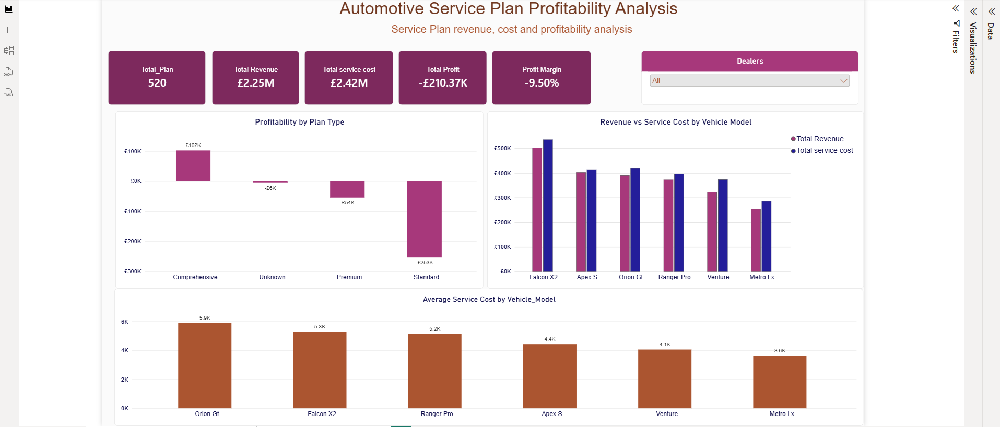
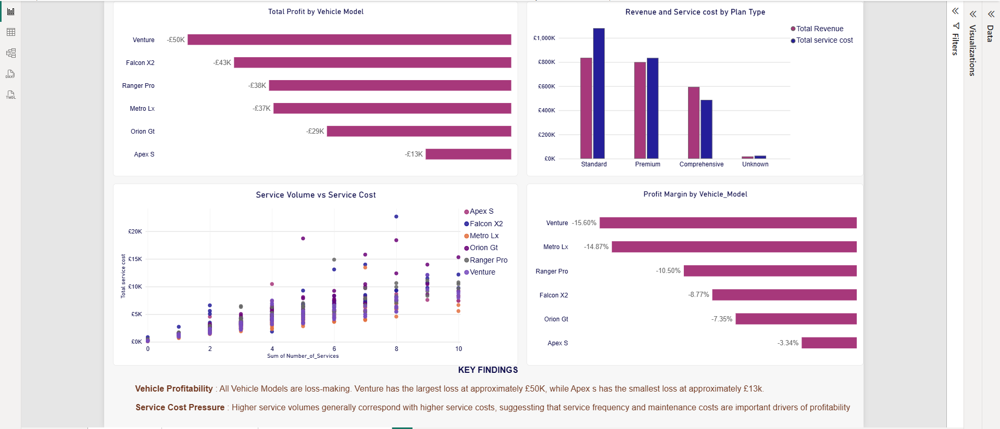
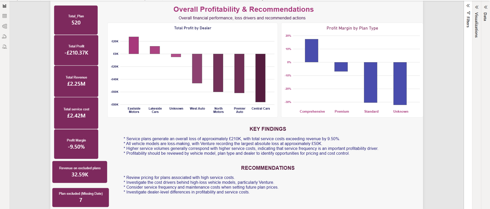

# Automotive Service Plan Profitability Analysis

**SQL · Power BI · DAX · Power Query**

> **Headline result:** The service plan portfolio made an overall loss of about **£210K (profit margin −9.50%)**. Every vehicle model was loss making, only **Comprehensive** plans were profitable, and service costs rose with service volume. The analysis recommends where management should review pricing and control costs.

*This is a portfolio project using synthetic data created for demonstration. No employer, customer or confidential data is used.*

---

## At a glance

| Metric | Result |
|---|---|
| Service plans in the dataset | 520 |
| Plans excluded from profit analysis (missing cost data) | 7 (£32.59K of revenue) |
| Total revenue (all plans) | £2.25M |
| Total service cost | £2.42M |
| Total profit | −£210.37K |
| Profit margin | −9.50% |

Profit and margin are calculated only on plans with complete cost data, so revenue and cost are compared on the same set of plans. See [Data validation and reconciliation](#data-validation-and-reconciliation).

---

## Business problem

A service plan provider needs to know whether its plans make money. This project answers:

1. How many plans were sold, and how much revenue did they generate?
2. How does profitability differ across plan types?
3. Which plan types lose money?
4. Which vehicle models have the highest service costs?
5. What are the main labour and parts cost drivers?
6. How does profitability vary across dealers?
7. Does service frequency influence service costs?
8. Where should management focus cost control and pricing reviews?

---

## Key findings

1. **The portfolio lost money.** Total service costs exceeded revenue by 9.50%, an overall loss of about £210K.
2. **The problem is portfolio wide.** All vehicle models were loss making. **Venture** had the largest absolute loss (about £50K), and **Falcon X2** combined high service frequency with a relatively high average cost per service.
3. **Only Comprehensive plans were profitable.** Comprehensive plans earned a positive margin (+17.39%), while Premium (−6.97%), Standard (−30.53%) and plans with an Unknown type made losses.
4. **Dealer performance varied widely.** Eastside Motors and Lakeside Cars were profitable, while the other dealers made losses, with Central Cars the largest (−£76,178.94).
5. **Service frequency is a cost driver.** Service costs generally increased with service volume, so plan pricing should reflect how often vehicles are serviced.

---

## Recommendations

1. **Review pricing and coverage** for the loss making plan types, especially Standard.
2. **Investigate high cost vehicle models**, particularly Venture, and the recurring maintenance costs behind them.
3. **Reflect service frequency and plan duration in pricing.** Costs rise with volume, so prices should too.
4. **Review labour and parts costs separately** to find specific cost control opportunities.
5. **Look into dealer differences** in profitability and service cost, and learn from the profitable dealers.
6. **Fix the Unknown records** (plan type and dealer) so future reporting is reliable.

---

## Data preparation

The dataset was deliberately built with realistic data quality problems:

- Duplicate records
- Missing dealer, plan type, mileage and parts cost values
- Inconsistent text formatting
- An unusual negative labour cost, which was investigated

**Approach:**
- Cleaned and standardised the data in **Power Query** before analysis.
- Classed missing categories that could not be reliably worked out as **Unknown** instead of guessing.
- Did not estimate or fill in missing costs.

---

## Data validation and reconciliation

I checked the financial relationships before reporting:

- Total Service Cost = Labour Cost + Parts Cost
- Profit = Total Revenue − Total Service Cost

While checking the dashboard totals, I found that revenue minus cost did not match the sum of the profit column. The cause was **7 plans with no service cost or profit value** (missing parts cost). They had revenue but could not be given a reliable profit.

**What I did:**
- Kept the 7 plans in the data because their other fields are valid.
- Made revenue, cost, profit and margin calculations use the **same set of plans**, so the totals reconcile.
- Reported the exclusion openly on the dashboard (7 plans, £32.59K of revenue).

**Effect on the result:** The profit margin moved from −9.37% to **−9.50%** once revenue and profit were calculated on the same plans.

---

## Key DAX measures

```DAX
Total Profit = SUM('Automotive Service plan profitability'[Profit])

Total Revenue (Complete) =
SUMX( FILTER('Automotive Service plan profitability', NOT ISBLANK( 'Automotive Service plan profitability'[Total service cost])),'Automotive Service plan profitability'[Total Revenue])

Profit Margin = DIVIDE([Total Profit], [Total Revenue (Complete)])
```

---

## SQL analysis

SQL was used to explore:

- Overall plan sales and revenue
- Profitability by plan type
- Average revenue and service cost
- Loss making plan types
- Vehicle model service costs
- Labour versus parts cost drivers
- Profitability by vehicle model and plan type
- Dealer profitability
- Unknown plan types and data quality issues

The full queries are in `automotive_service_plan_profitability_analysis.sql`.

---

## Power BI dashboard

**1. Executive Overview:** total plans, revenue, service cost, profit and margin, with revenue versus service cost by vehicle model, profitability by plan type, and average service cost by model.



**2. Vehicle & Plan Profitability:** profitability and service cost by vehicle model and plan type, and the relationship between service volume and cost.



**3. Overall Profitability & Recommendations:** profit by dealer, margin by plan type, key findings and recommended actions.



---

## Skills demonstrated

- Writing SQL to answer business questions
- Data cleaning and transformation in Power Query
- Data modelling and DAX measures in Power BI
- Data validation and reconciling totals
- Dashboard design and data visualisation
- Turning analysis into clear business recommendations

---

## Limitations

- The data is synthetic, so the results demonstrate the analytical approach and are not real business findings.
- The link between service volume and cost shows a relationship, not proof of cause.
- 7 plans with missing cost data were excluded from profit analysis, and Unknown categories remain in some views.

---

## Project files

| File | Description |
|---|---|
| `Automotive service plan profitability Project.pbix` | Power BI report |
| `automotive_service_plan_profitability_analysis.sql` | SQL analysis |
| `images/` | Dashboard screenshots |

---

*Updated 28 October 2026: revenue and margin now use the same plans as profit (7 plans with missing cost data excluded).*

**Author:** Daniel Akhimie · [LinkedIn](https://www.linkedin.com/in/daniel-akhimie-770a43261/)
